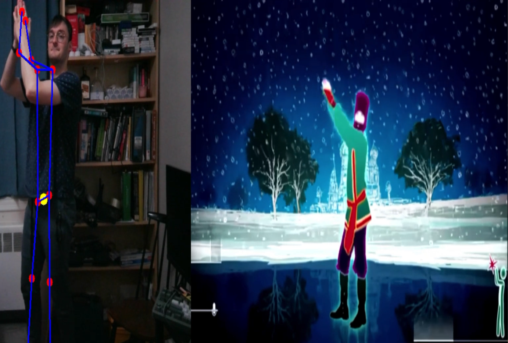

# JustDance-Fanmade

JustDance-Fanmade is an unofficial dance game written in Python. Follow the choreography in front of your webcam. The game uses YOLO to detect your pose, compares it with the reference poses, and gives you feedback during the song.

## Installation

You'll need Python and a webcam. From the project root, install the dependencies.

```powershell
python -m pip install -r requirements.txt
```

[Download the project assets from SharePoint](https://polymtlca-my.sharepoint.com/:f:/g/personal/sidney_gharib_etud_polymtl_ca/IgDY8vg9BqqORrIe_oCFqKwUAb6w_5k6j4swtrOnrSm066o?e=0qK07N) and extract the archives into the project root. Make sure there is one top-level `labels` folder and one top-level `musics` folder, with no duplicate folders nested inside them. Place `yolo26n-pose.onnx` next to `dance.py`.

The default song uses this file layout.

```text
JustDance-Fanmade/
├── dance.py
├── yolo26n-pose.onnx
├── labels/
│   └── Rasputin/
│       └── 0.json (and the remaining pose files)
└── musics/
    └── Rasputin/
        ├── audio/Rasputin.mp3
        └── video/Rasputin.mp4
```

## How to play

Run this command from the project root.

```powershell
python dance.py
```

**Rasputin** starts with your webcam feed and the reference video side by side. Press **Q** in the game window to quit. The final score appears in the terminal.

The repository also contains commented-out code you can enable to experiment.
